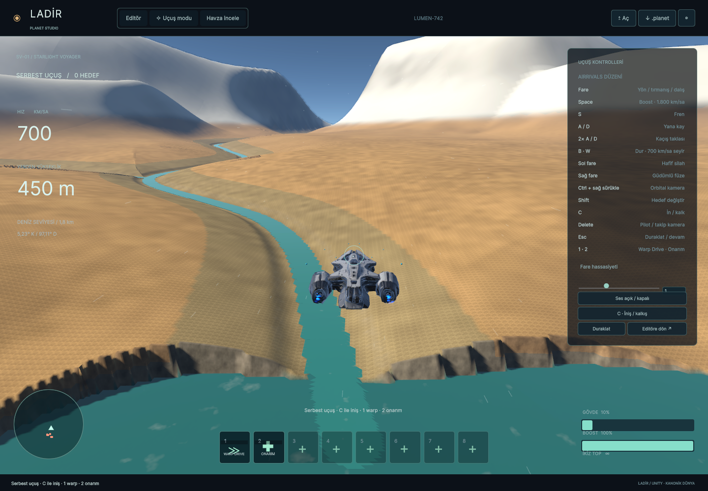
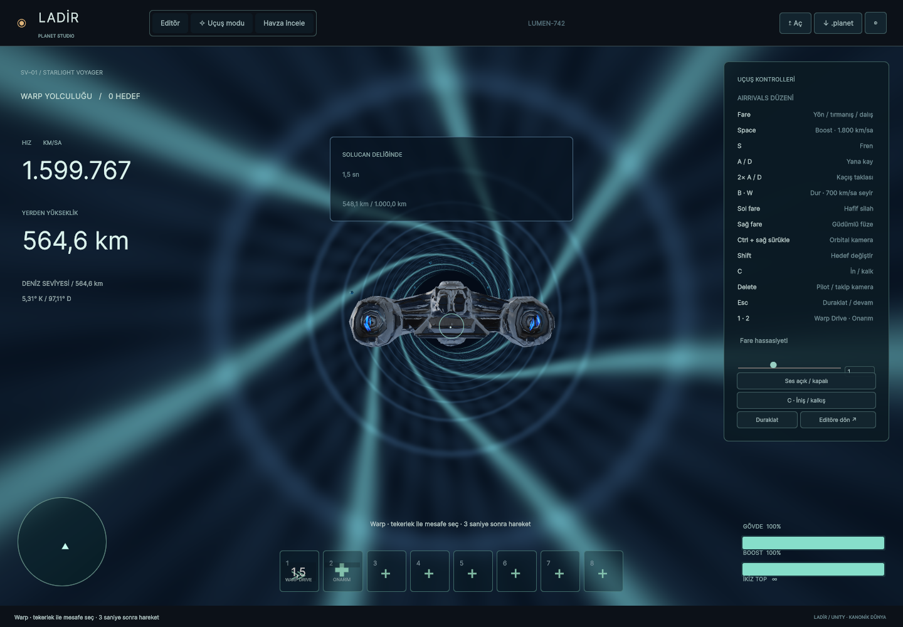
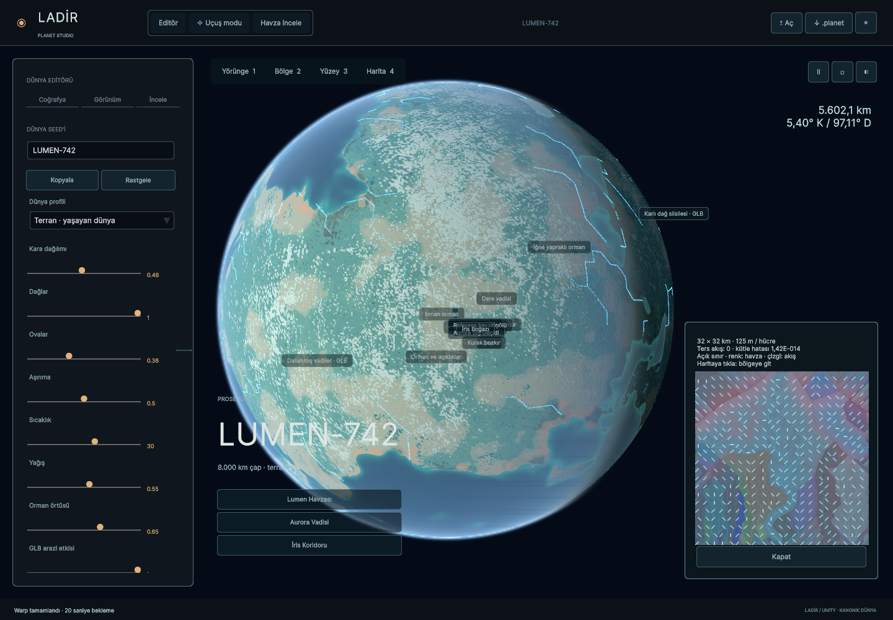

# LADİR — Unity oyuncu doğrulaması

> Bu belge önceki 1440×1000 doğrulamasıdır. Açılışı da kapsayan yeni, aynı rotalı 1920×1080 karşılaştırması ve kod düzeltmeleri [donma incelemesinde](PERFORMANCE_STUTTER_FIX.md) yer alır. Farklı çözünürlük ve rotalardaki FPS sonuçları doğrudan karşılaştırılmamalıdır.

**25 Ekim 2026 · Çalışan Windows derlemesi.** Kaynak web: v1.26.1 / `34841d6`. Unity 6000.0.80f1, URP 17, Direct3D 11, GTX 1660 Ti; 1440×1000, render scale 1, 4× MSAA. VSync kapalı, FPS limiti yok. Editör açık kaldı; karşılaştırma için açtığımız web test sekmesi ölçüm sırasında boş sayfaya alındı.

## Sonuç

- Gezegen çapı **8.000 km**, yarıçapı **4.000 km**. Özgün paket ve coğrafya imzası korundu.
- Windows build: **başarılı, 0 hata, 2 uyarı**, yaklaşık 199 MB. Uyarılar kurulu Unity Tutorial/App UI editör paketlerine ait; çalışma testinde hata yok.
- 24 saniyelik normal uçuş: **ortalama 91,15 FPS**, p95 **12,89 ms**, p99 **14,35 ms**. 2.188 ölçülmüş karede bir kez **50,67 ms** görüldü.
- Sabit 100 FPS sağlanmış değildir. Bu test 60 Hz ekran sınırıyla karıştırılmamalı; sunum/kare aralığı ve GPU işlem zamanı ayrı kaydedildi.
- Warp tüneli yüksek hızda görünür kaldı; 1.000 km uzaya warp tamamlandı ve 700 km/sa seyire döndü. Önceki ekran görüntüsündeki görünmez tünel, fizik konumu ile interpolasyonlu render konumu arasındaki farktan kaynaklanıyordu.
- 16.709 farklı LOD kenar örneğinde en büyük açıklık **8,74 mm**; test eşiği 100 mm. Bu, bütün gezegendeki tüm LOD/köşe geçişlerinin doğrulandığı anlamına gelmez.
- GPU FFT ile CPU referansı arasındaki en büyük fark **9,24e-7 m**; eşik 1e-4 m.
- Havza ekranı 32×32 km alanı **125 m/hücre** ile açtı. Son yüzeyden teşhis üretir; araziyi değiştirmez.

## Senaryolar

| Senaryo | Kare | p95 / p99 | En uzun | GPU p95 | >50 ms |
| --- | ---: | ---: | ---: | ---: | ---: |
| Normal uçuş, 24 sn | 2.188 | 12,89 / 14,35 ms | 50,67 ms | 12,39 ms | 1 |
| Bulut 0,8 + boost + silah/füze, 8 sn | 748 | 12,66 / 14,13 ms | 24,39 ms | 11,98 ms | 0 |
| Boost bırakma + silah, 8 sn | 644 | 14,26 / 16,17 ms | 27,74 ms | 13,78 ms | 0 |
| Warp dolumu, 2 sn | 478 | 7,18 / 13,86 ms | 18,77 ms | 5,00 ms | 0 |
| Warp tüneli, 2 sn | 593 | 5,26 / 9,62 ms | 34,92 ms | 4,57 ms | 0 |
| Varış ve yavaşlama, 4 sn | 1.464 | 4,73 / 5,72 ms | 12,15 ms | 3,79 ms | 0 |

Bunlar farklı yüklerdir; uzaydaki FPS'yi alçak uçuş kazancı olarak kullanmıyoruz. Boost aşamasının sonunda enerji tükenmiş olabilir; tablo sekiz saniyenin tamamını içerir. Ekran görüntüsü yazma beklemeleri aşama ölçümlerinin dışında kalır. Soğuk başlatma süresi, ilk yüzey ve tam ayrıntıya varış süresi bu koşuda ayrı ölçülmedi.

## İşleme maliyeti ve bellek

Normal uçuşta GPU p95 12,39 ms. CPU frame p95 12,90 ms, fakat bu pipeline beklemelerini içerir: GPU süresiyle toplanamaz. Ayrı zamanlanan arazi planı p95 0,79 ms, gönderim/çizim hazırlığı 1,87 ms, kenar bağlama 0,84 ms, upload 0,70 ms ve uçuş simülasyonu 0,36 ms. Kenar bağlama gönderim ölçümünün içinde yer alır; birbirine eklenmez.

En yüksek tek upload 7,82 ms, kenar bağlama 8,22 ms; hedef bütçe bir mesh işleminin ortasında kesilemediği için aşılabiliyor. İlk uçuş geçişinde 31,9–49,4 ms kareler de var. Tek 50,7 ms karenin kesin nedeni yalnız bu sayaçlardan belirlenemez; GC, sürücü/pipeline ve upload ayrımı için ayrıntılı profiler kaydı gerekir.

Son görüntüde Unity allocated memory 325,03 MiB; terrain mesh payload tahmini 187,87 MiB, terrain resident payload tahmini 364,27 MiB. Bunlar farklı kapsamlar ve tepe değerleri değildir. Gerçek sürücü VRAM ölçümü yapılmadı. Ara kontrol oyuncu çalışma kümesini yaklaşık 1,5 GiB gösterdi; sürekli süreç bellek kaydı değildir.

## Doğrulanan testler

- 2.118 arazi/biyom/hidroloji örneği; yükseklik farkı en fazla 6,96e-11 m.
- 2.439 ağaç / 8 tile: kanonik kök ve tür yerleşimi eşleşti.
- 1.534 fizik, iniş/kalkış, onarım, warp, çarpışma, kara/su rota ve kayıt kontrolü.
- 1.089 teşhis drenaj düğümü; akış alıcısı/havza farkı yok, ters akış yok.
- 216 doğrudan DFT örneğinde en büyük dalga farkı 2,40e-7 m.
- Üç mevcut Node testi geçti, atlanan test yok.
- C# kaydı özgün web okuyucusunda aynı kanonik hash ile açıldı.
- Aynı yeni seed üretimi tekrarda aynı sonucu verdi.
- Unity API derleme kontrolü 0 hata/uyarı; ayrıca gerçek Unity Windows build ve görünür oyuncu testi tamamlandı.

## Görüntüler

Aşağıdakiler gerçek Unity oyuncusundan. İlk ve son editör görüntüsü aynı açılış kamera ayarlarını kullanır; shader ve görünüm yükü farklı olduğundan eşit iş yüküyle performans A/B testi sayılmaz. Web ile piksel düzeyinde aynı ışık/kamera karşılaştırması tamamlanmadı.

[Önceki native editör](../evidence/planet-port/native-player-visible-baseline/01-editor.png) · [Son native editör](../evidence/planet-port/native-player-final/01-editor.png)







## Kalan işlerin önceliği

1. **Görsel eşlik:** kıyı tırtıkları, yörünge kar/malzeme maskeleri, bulut/gölge ışığı. Sayısal yükseklik eşliği tek başına görsel eşlik değildir.
2. **GPU maliyeti:** mevcut çözünürlük ve detay korunarak arazi/hacim pass'lerini GPU profiler ile ayırmak; 10 ms bütçesinin üstündeki maliyeti düşürmek.
3. **Uzun kareler:** ilk uçuş geçişi, tek mesh upload ve kenar düzenlemeyi daha küçük işlere bölmek; gerçek tahsis/GC kaydı.
4. **Aktarımın kalan mimarisi:** ortak GPU grid/displacement, küresel bölgesel bake/cache bağlantısı ve sürekli LOD morph. Mevcut eski bölgesel sahne korunuyor.
5. **Uzun rota ve kayıt:** tüm cube kenarları/köşeleri, su birleşimleri, yoğun ağaç bölgeleri ve saatlik uçuş testi; global düğüm budama, yan dosyasız kanonik hash doğrulaması.

Tam görsel/mimari aktarım bitmiş sayılmıyor. Bu teslim çalışan ve ölçülmüş yeni native sürümdür.

## Tekrarlama ve kanıt

```powershell
./tools/test-native-kernel.ps1
$env:LADIR_WEB_SOURCE = 'C:/Projects/ladir'
npm.cmd test
Builds/Planet/Ladir.exe --planet-smoke C:/Tests/ladir --extended -screen-width 1440 -screen-height 1000 -screen-fullscreen 0
node tools/summarize-native-smoke.mjs C:/Tests/ladir/smoke.json
```

Oyuncu **görünür pencereyle** çalıştırılmalıdır. Gizli pencereyle yapılan ilk denemede render atlandığı, GPU süreleri sıfır ve görüntüler siyah olduğu için bu sonuçlar reddedildi. Kısa eski editör testi ve eski 32×32 km prototip FPS'si bu rapora taşınmadı.

[Ham son koşu](../evidence/planet-port/native-player-final/smoke.json) · [Özet](../evidence/planet-port/native-player-final/summary.json) · [Build sonucu](../evidence/planet-port/native-player-final/build.json) · [Aktarım kapsamı](PLANET_PORT.md)
