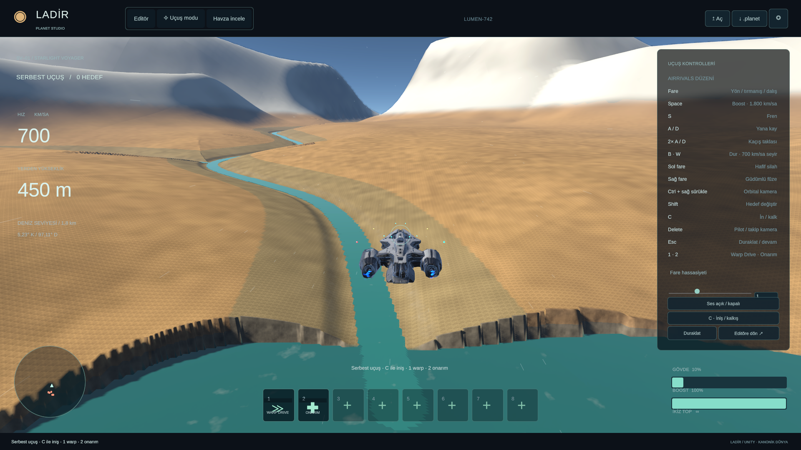

# LADİR — açılış ve uçuş takılmaları

25 Ekim 2026. Bu çalışma, `codex/native-planet-port` dalındaki `767d4f4` sürümünü temel alır. Eski 32 km prototipinin veya farklı çözünürlükteki kısa uçuşun FPS'si bu karşılaştırmada kullanılmaz.

## Bulunan nedenler ve uygulama

**Hazır arazi ekrana geç ulaşıyordu.** Eski kuyruk, görünür ana parçanın eksik çocuğunu tamamlamak yerine görünmeyen derin torunları üretebiliyordu. Warp/hareket yönündeki tahmini talepler de görünürlük talepleriyle aynı bayrağı kullanıyordu. Bir eksik komşu hazır olduğunda tek karede 749 ek parça görünür hâle gelebildi. Bu, hem ayrıntı beklemesine hem kenar bağlama ve renderer etkinleştirme yığılmasına neden oldu.

Yeni kuyruk önce **görünür yüzeyi iyileştirecek çocukları** tamamlar. Tahmini ön yükleme ile mevcut kamera görünürlüğü ayrıldı. Hazır bir alt ağacın açılması kare başına iki kardeş grubu ve bir derinlik adımıyla sınırlı; geçerli ana parça hazır çocuklar devralana kadar korunur. Kamera dönüşleri için görünür dalın bir katmanlık komşu kardeşleri de önceden istenir; görünmeyen torunları üretilmez. İlk quadtree kuruluşu kareye yığılmaz; plan başına 128 yeni düğüm sınırı vardır.

**Mesh teslimi ve kenar güncellemesi fazla kopyalama yapıyordu.** Ortak grid indeksleri artık tek kez oluşturulur. Normal, malzeme, bounds ve GPU sırasındaki vertex verisi Worker tarafında hazırlanır. Ana thread'de `SetVertexBufferData` ile ayrı konum/sabit öznitelik akışları kullanılır. Mesh kurma, yükleme ve yayınlama aşamaları ayrıldı. Yayınlama atomiktir: yarım yüklenmiş parça ana yüzeyi kaldıramaz.

32 hücreli gridde kenar+etek vertexleri GPU akışının başına taşındı: bir LOD kenar düzeltmesinde 1.221 vertexin bütün öznitelikleri yerine **260 konum / 3.120 bayt** güncellenir. CPU'daki satır düzeni değişmez. Bounds, düzeltilmiş kenarları kapsar. Yakın ağaç kökü sorguları da aynı görüntülenen CPU üçgenini kullanır.

Upload için **2 ms yumuşak bütçe**, en çok üç tamamlanan parça/kare uygulanır. Tek bir Unity/native çağrısının ortasında durdurulamadığı için bu, mutlak 2 ms garantisi değildir. Cache boşaltma da küçük gruplara bölündü. Floating-origin konumları her kare yerine yalnız 1.024 m referans hücresi değiştiğinde yeniden yazılır.

**Ağaçların dönüşümleri tekrar hesaplanıyordu.** Altı ayrı tür/LOD döngüsü tek dolaşıma indirildi. Dönüş ve ölçek korunur; yalnız kök veya floating origin değiştiğinde konum matrisi güncellenir. Instancing tamponları ve kök kayıtları yeniden kullanılır. Ağaç nüfusu ve mesafeleri azaltılmadı.

**Dünya başlığı iki kez nesneleştiriliyordu.** Yaklaşık 7,5 MB JSON başlığı önce büyük bir `JObject` ağacına, sonra ikinci bir typed nesne ağacına açılıyordu. Çalışma anında doğrudan typed yükleme yapılır. Özgün başlık sonradan kayıt gerektiğinde açılmak üzere korunur; bilinmeyen alanlar ve ikili tamponlar kaybolmaz. Paket sürümü, yarıçapı, çekirdek imzası ve SHA-256 doğrulamaları korunur.

**İlk UI ve render hazırlığı belirgin bir açılış maliyeti.** Development profiler kaydının ilk karesinde UI layout/repaint ve ilk URP render hazırlığı büyük yer tutuyordu. HUD'un bilinen Latin/Türkçe karakterleri ve sembolleri editörde SDF atlasına hazırlandı. Kullanıcının farklı metinleri için dinamik fallback korunur. Bu tek başına ilk kare takılmasını tamamen çözmedi; Mono ve IL2CPP karşılaştırması bu yüzden ayrıca yapıldı.

Bulut shader'ındaki geçmiş kareyi kullanma seçimi açık dallanmayla yazıldı. Bunun tek başına büyük bir GPU/FPS kazancı sağladığı doğrulanmadı. Yarı çözünürlük, ray adımı ve zamansal örnekleme kalitesi değiştirilmedi.

## Ölçüm koşulları

- Unity 6000.0.80f1, URP 17, Direct3D 11, GTX 1660 Ti.
- Görünür Windows oyuncusu, **1920×1080**, render scale 1, **4× MSAA**; VSync ve FPS limiti kapalı. Editör Play dışında, aynı anda başka LADİR oyuncusu çalışmıyor.
- `river-v42.planet`, SHA-256 `07e3a31e5068b59f6208fc880c1a6e2f0455b595e9475c833372625ecb2c1e3f`; çap **8.000 km**, yarıçap **4.000 km**.
- Aynı kamera başlangıcı, 700 km/sa seyir, 1.800 km/sa boost, aynı **60 Hz fizik adımında** atanan girdiler. Render FPS'si girdi zamanını değiştirmez.
- Aynı grid 32, azami LOD 19, ekran hatası 2,5 piksel. Görüş mesafesi, ağaç yoğunluğu, çözünürlük ve efektler kısılmadı.
- Açılış ve 64 simülasyon saniyesi uçuş kaydedilir: giriş, seyir, boost/çatışma, boost bırakma, dönüş, dalış, toparlanma. Ekran görüntüsü ve ağır sayısal yüzey doğrulaması zamanlanan rotanın **sonrasında** yapılır.
- İlk sunum/yüzey zamanları Unity çalışma saatiyle ölçülür; işletim sisteminin süreç başlatma ve Unity'nin bu saati başlatmasından önceki yükleme süresini kapsamaz. İlk açılışın tamamı için bu ayrım önemlidir.
- FrameTiming sayaçları gecikmeli olabilir. CPU toplamı, aktif ana thread, render thread, sunum beklemesi ve GPU zamanı birbirine eklenmez. GPU süresi sıfır olan örnekler GPU yüzdeliklerine alınmaz.
- Release sürümünde `GC Allocated In Frame` sayacı kullanılamadı. Mono'da thread tahsis API'si ayrıca kaydedildi; Unity 6000.0 IL2CPP bu API'yi uygulamadığından o alanda `-1`/bilinmiyor döndürülür. GC collection sayısı tek başına takılmanın sebebini kanıtlamaz.

## Ölçülen sonuç

| Ölçüt | Eski Mono | Düzeltilmiş IL2CPP, ilk koşu | Aynı IL2CPP, tekrar |
| --- | ---: | ---: | ---: |
| İlk sunulan kare, Unity saati | 2,415 sn | 1,995 sn | 0,448 sn |
| İlk görünür terrain parçası | 4,048 sn | 2,087 sn | 1,713 sn |
| Uçuşa girişten sonra geminin altında ≤8 m/hücre | 9,094 sn | 0,141 sn | 0,141 sn |
| Uçuş sırasında en uzun kenar bağlama işi | 19,933 ms | 3,656 ms | 3,428 ms |
| Uçuş sırasında en uzun upload işi | 4,207 ms | 2,619 ms | 3,614 ms |
| 64 simülasyon sn boyunca >50 ms kare | 2 | 2 | 1 |
| En uzun uçuş karesi | 99,284 ms | 87,070 ms | 54,347 ms |
| Uçuş frame p95 / p99 | 18,196 / 21,059 ms | 20,074 / 22,619 ms | 20,119 / 22,324 ms |
| Uçuş ortalama FPS | 96,17 | 73,47 | 72,40 |
| Terrain resident payload tepe tahmini | 409,4 MiB | 593,4 MiB | 591,5 MiB |
| Terrain mesh payload tepe tahmini | 207,2 MiB | 298,4 MiB | 297,6 MiB |

**Yükleme gecikmesi ve arazi geçiş işi iyileşti; genel FPS artışı sağlanmadı.** Eski koşunun ilk dokuz saniyesinde yakın ayrıntı henüz görüntülenmiyordu. Dönüş/toparlanma sırasında da yüzlerce parça aynı anda kapanıp açılabiliyordu. Yeni sistem ayrıntıyı daha erken ve daha sürekli gösterdiği için GPU daha fazla süre ayrıntılı yüzeyi işler. Bu, FPS düşüşünü gizlemek için kullanılabilecek bir gerekçe değil; sonuçların birlikte değerlendirilmesi gereken açık bir maliyetidir. Dönüş/dalış aşamasının GPU yükü hâlâ düşürülmeli.

Test uçuşa **kernel hazır olduktan 10 saniye sonra** başlar; yakın ayrıntı sütunu bu girişten sonraki gecikmedir, uygulamanın toplam açılış süresi değildir. İlk terrain parçası kaba ana LOD olabilir; bütün ekranın tam ayrıntı kazanmasıyla aynı ölçüt değildir. Tekrar koşusunda dosya/sürücü önbellekleri temizlenmedi. Açılışın ilk uzun karesi ilk IL2CPP koşusunda 1.827 ms, tekrarda 309 ms idi; tek sıcak koşudan soğuk başlatma garantisi çıkarılmamalıdır.

| Aşama | Eski p95 / p99 | Son tekrar p95 / p99 | Son tekrar en uzun |
| --- | ---: | ---: | ---: |
| Uçuşa giriş | 14,91 / 17,67 ms | 17,39 / 19,49 ms | 54,35 ms |
| Seyir | 16,52 / 18,01 ms | 16,31 / 17,75 ms | 20,17 ms |
| Boost + çatışma | 16,42 / 18,06 ms | 16,08 / 17,76 ms | 19,54 ms |
| Boost bırakma | 18,92 / 21,03 ms | 19,34 / 20,45 ms | 22,31 ms |
| Dönüş | 14,81 / 19,87 ms | 21,82 / 24,21 ms | 32,56 ms |
| Dalış | 21,48 / 32,71 ms | 22,49 / 23,45 ms | 25,77 ms |
| Toparlanma | 18,11 / 20,88 ms | 18,86 / 21,52 ms | 25,08 ms |

İlk IL2CPP koşusundaki 87 ms karenin yakınında gecikmeli GPU sayacı 83,6 ms gösterdi; plan/upload/kenar işi o karede küçüktü, GC collection sayısı değişmedi. Tekrar koşusunda bu sıçrama görülmedi. Bunun kesin shader, sürücü veya işletim sistemi nedeni bu sayaçlarla ayrıştırılmış değildir. Yaklaşık 54 ms'lik uçuşa giriş karesi iki IL2CPP koşusunda da kaldı.

Ara Mono uygulaması da saklandı: yakın ayrıntı gecikmesi 0,377 sn, en uzun uçuş karesi 48,92 ms, >50 ms kare sayısı sıfırdı; ancak ilk kare 3,546 sn ve uçuş p95 19,52 ms idi. Son komşu-halka politikası bu ara koşudan sonra eklendi. Dolayısıyla bu veri, **yalnız backend değişiminin izole A/B'si değildir**. Sonuçları kanıtlamayan “IL2CPP her şeyi hızlandırdı” iddiası yapılmıyor.

## Doğrulama ve görseller

- Gerçek **IL2CPP oyuncusunda 2.118** web referans örneği: sıfır hata; en büyük yükseklik farkı **6,96e-11 m**, su kotu farkı sıfır. Altı dünya tipi aynı referansla kontrol edildi.
- Son oyuncuda **941.391 GPU vertex konumu** görüntülenen CPU yüzeyiyle birebir aynı; indeks uyuşmazlığı sıfır. 17.174 karışık LOD kenar örneğinde en büyük açıklık **8,74 mm**.
- Ayrı native görsel/işlev koşusu: normal uçuş, yoğun bulut/çatışma, boost bırakma, **1.000 km uzaya warp**, varış ve havza inceleme ekranı tamamlandı; runtime hata listesi boş. GPU FFT / CPU referansı farkı **9,91e-7 m**. Bu koşudaki normal uçuş p95 **16,31 ms**; açılışı dışarıda bırakan bu ölçüm ana A/B'nin yerine kullanılmadı.
- Portable testler: 2.118 arazi örneği, 2.439 ağaç, **1.564** fizik/rota/kayıt kontrolü, 1.089 drenaj düğümü, 216 dalga örneği geçti. Typed yüklemenin bütün bilinmeyen JSON alanlarını ve 27 ikili tamponu kayıpsız koruduğu test edildi. C# kaydı özgün web okuyucusunda aynı kanonik hash ile açıldı.
- Mevcut üç Node testi geçti; atlanan test yok. Unity API derleme kontrolü sıfır hata/uyarı. Son gerçek IL2CPP build: sıfır hata, **5 uyarı** (kurulu Tutorial/App UI paketlerinden iki ve TextMeshPro C++ derleme bölümlendirmesinden üç). İlk tam AOT derlemesinde ayrıca Sentis shader uyarıları vardı; ilk build raporu da saklandı.

Türkçe HUD, arazi, gemi ve warp görüntüleri gerçek oyuncudan kontrol edildi. **Kıyı/göl kenarı tırtıkları ve yüzey dokusu tekrarı hâlâ görülüyor**; bunlar bu performans düzeltmesiyle çözülmüş sayılmadı. Aşağıdaki görsel koşu zamanlanan A/B ile ayrı tutulur.



[Editör](../evidence/performance/native-aot-validation/01-editor.png) · [Yoğun bulut/çatışma](../evidence/performance/native-aot-validation/04-cloud-boost-combat.png) · [Warp](../evidence/performance/native-aot-validation/07-warp-tunnel.png) · [Havza](../evidence/performance/native-aot-validation/09-reference-analysis.png)

## Kalan darboğazlar

1. **100 FPS sağlanmadı.** Son rotada GPU p95 aşamaya göre yaklaşık **15–21 ms**; 100 FPS bütçesi 10 ms. Arazi, atmosfer/bulut ve gölge pass'leri ayrı GPU yakalamasıyla ölçülmeli. Genel GPU sayacından hangisinin ne kadar pay aldığı kesin çıkarılamaz. Çözünürlük veya efekt azaltımı bu teslimde yapılmadı.
2. **İlk uçuş geçişi:** tekrarlanan yaklaşık 54 ms kare kaldı. UI ilk yerleşimi, materyal/PSO ilk kullanımı ve bulut geçmişinin yenilenmesi ayrı işaretlerle incelenmeli; bu üçünden biri kanıtlanmadan tek neden diye sunulmamalı.
3. **Tek native upload çağrısı:** ana uçuş rotasında küçük olsa da ayrı warp testinde bir upload **18,68 ms** sürdü; tam kare 21,88 ms idi. Yumuşak bütçe tek çağrıyı bölemez. Sonraki aday, sabit mesh/buffer havuzu veya ortak GPU grididir; CPU yüzey/kenar eşitliğiyle birlikte doğrulanmalıdır.
4. **Bellek ve uzun rota:** 384 MiB resident hedefi **sert sınır değildir**. İstenen/görünür yüzey korununca hedef aşılabilir; komşu ön yüklemeyle bu testte yaklaşık 593 MiB payload görüldü. Unity allocated ve managed heap farklı kapsamlardır; bu tahminlerle toplanamaz. Son oyuncu Unity allocated yaklaşık 356 MiB, managed heap örnekleri 785–914 MiB idi. Gerçek sürücü VRAM tepe ölçümü ve saatlik uçuş testi yapılmadı. Cache kabul kontrolü, düğüm budama ve isteklerin bayt bütçesine göre önceliklendirilmesi tamamlanmalı.
5. **İlk açılış:** UI atlası ve typed dünya yükleme iyileştirmelerine rağmen ilk pipeline/sürücü hazırlığının uzun karesi tamamen kalkmadı. Shader/PSO hazırlığı ölçülerek aşamalı önden hazırlama değerlendirilmeli. Kurulu editörün App UI/Sentis gibi oyunda kullanılmayan paketleri ayrıca paketleme maliyeti yaratıyor; bu turda kullanıcının editör paketleri kaldırılmadı.

## Değişen kod ve kanıt dosyaları

- `PlanetTerrain.cs`, `PlanetMeshData.cs`: kuyruk, kardeş geçişi, ortak CPU topolojisi, doğrudan vertex akışları, aşamalı upload ve cache boşaltma.
- `PlanetVegetation.cs`: tek dolaşım, tekrar kullanılan tamponlar ve değişmedikçe korunan dönüşümler.
- `Kernel/PlanetWorld.cs`, `PlanetStudio.cs`: tek geçişli dünya yükleme, kayıpsız metadata, başlangıç ölçümleri ve sabit fizik test kancası.
- `PlanetFontBake.cs`, `PlanetHUD.cs`, `PlanetSetup.cs`, generated font/panel/scene ve OFL font kaynakları: hazırlanmış HUD atlası.
- `PlanetProfilerTools.cs`, `PlanetPerformanceRun.cs`, `PlanetStartupProfile.cs`, `PlanetNativeParity.cs`, `link.xml`: ayrı AOT build, gerçek oyuncu doğrulaması, başlangıç yakalama ve desteklenmeyen sayaçların açık işaretlenmesi.
- `Clouds.shader`, testler, özet aracı, launcher ve bu rapor.

[Eski koşu](../evidence/performance/baseline-isolated/summary.json) · [Ara Mono koşusu](../evidence/performance/optimized-final/summary.json) · [Son AOT koşusu](../evidence/performance/optimized-aot/summary.json) · [Tekrar](../evidence/performance/optimized-aot-repeat/summary.json) · [Native kernel eşliği](../evidence/performance/native-aot-validation/kernel.json) · [Görsel/işlev testi](../evidence/performance/native-aot-validation/summary.json)

Her ölçüm klasöründeki `frames.json.gz` ham kareleri içerir. `profile-before/profile-summary.json` teşhis içindir; inclusive profiler süreleri üst üste biner, toplanmaz. Performans örneklemi iki son koşu ve tek eski koşudur; farklı donanım veya saatler süren uçuş için garanti değildir.

## Kaynaklar ve yöntem seçimi

- [Unity Mesh API örnekleri](https://github.com/Unity-Technologies/MeshApiExamples): ortak düzen, Jobs/Burst ve doğrudan vertex akışı yaklaşımlarının resmi örnekleri. Örnek projenin hızlanma oranları LADİR'e taşınmadı. Bu teslim global sampler'ın tamamını Burst'e çevirmiyor.
- [SetVertexBufferData](https://docs.unity3d.com/6000.0/Documentation/ScriptReference/Mesh.SetVertexBufferData.html): akış düzenini doğru kurup değişen aralığı yüklemek. İndeks doğrulamasını kaldıran yol için CPU/GPU sıra ve indeks eşitliği testi eklendi.
- [Unity frame timing sayaçları](https://docs.unity3d.com/6000.0/Documentation/Manual/frame-timing-manager-counter-reference.html): ekrandaki “CPU main” değerinin tek başına saf CPU iş yükü olarak yorumlanmaması; beklemelerin ayrılması.
- [UI Toolkit font varlıkları](https://docs.unity3d.com/6000.0/Documentation/Manual/UIE-font-asset.html): bilinen HUD metni için static atlas, bilinmeyen kullanıcı metni için dynamic fallback.
- [IL2CPP backend](https://docs.unity3d.com/6000.0/Documentation/Manual/scripting-backends-il2cpp.html): çalışma sırasında JIT yerine önceden makine koduna derleme. LADİR'deki etkisi yalnız gerçek oyuncu ölçümüyle değerlendirilir.

## Tekrarlama

```powershell
# Kurulu Unity paketleriyle portable kernel ve özgün web okuma kontrolleri
./tools/test-native-kernel.ps1
$env:LADIR_WEB_SOURCE = 'C:/Projects/ladir'
npm.cmd test

# Editörde LADIR menüsünden Windows veya ayrı IL2CPP build alındıktan sonra
Builds/Planet/Ladir.exe --performance-run C:/Tests/ladir -screen-width 1920 -screen-height 1080 -screen-fullscreen 0
node tools/summarize-performance.mjs C:/Tests/ladir
Builds/Planet/Ladir.exe --planet-smoke C:/Tests/ladir-visual --extended -screen-width 1920 -screen-height 1080 -screen-fullscreen 0
```

Eski sürüm karşılaştırmasına yalnız zamanlama ve aynı fizik girdisini veren test kancaları eklendi. `.raw` development profiler kaydı ve ara araştırma koşuları performans yüzdesi hesabına katılmaz. İki oyuncunun aynı anda açık olduğu ilk araştırma koşuları son A/B'den çıkarıldı. Önceki 1440×1000 raporu tarihsel doğrulama olarak tutuldu.
