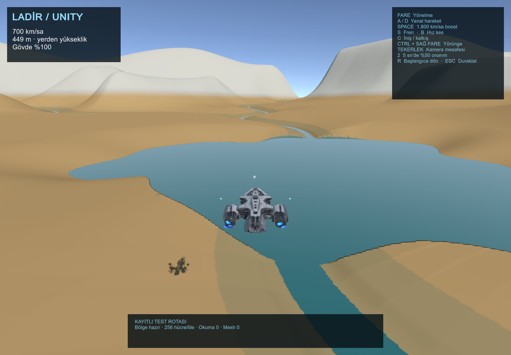
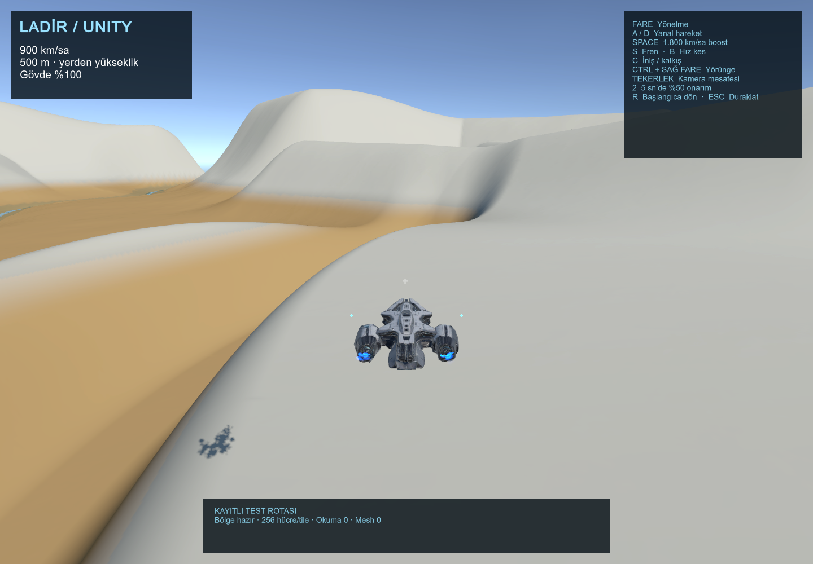

# LADİR Unity prototipi — uygulama ve doğrulama

25 Ekim 2026. Unity 6000.0.80f1, Windows, URP 17.0.4, Burst ve Jobs.

## Çalışan kapsam

Mevcut `river-v42.planet` kaydının 32 × 32 km referans bölgesi Unity'ye aktarıldı. Kaynak dünyada çap **8.000 km**, yarıçap **4.000 km**. Yer şekilleri ikinci bir üreticiyle yeniden tasarlanmadı; mevcut `sampleTerrain` sonuçları örneklendi. Bu, bütün gezegenin Unity'ye taşındığı anlamına gelmiyor.

256 adet 2 × 2 km paket, paket başına 257 × 257 örnek ve 7,8125 metre en ince aralık kullanılıyor. Göl ve akarsu kotları, yükseklikler ve biyom renkleri aynı kaynaktan geliyor. Veriler SHA-256 ile kontrol ediliyor. Sıkıştırılmış bölge boyutu **53,68 MiB**; çevrimdışı üretim bu makinede **104,7 saniye** sürdü. Oyun sırasında bu üretim tekrarlanmıyor.

110 metrelik Starlight Voyager, 700 km/sa seyir, 1.800 km/sa boost, fareyle uçuş, iniş/kalkış, Ctrl + sağ fare ile orbital kamera, 5 saniyede %50 onarım ve 30 saniye bekleme eklendi. Kontroller sağdaki panelde gösteriliyor. Dünya sınırı bu prototipte 32 km'lik alanla sınırlı.

Dosya okuma/açma işleri üç, geometri işleri dört eşzamanlı görevle sınırlı. Burst işleri tamamlanmadan ana thread onları beklemiyor. GPU'ya mesh gönderimi kare başına 2 ms CPU bütçesi hedefliyor; tek büyük gönderim bu sınırı aşabiliyor. Eski yüzey, yeni LOD kenarları birlikte hazır olana kadar korunuyor. Çarpışma sorguları ekrandaki üçgenleri kullanıyor. Örnek verisi önbelleği 96 MiB ile sınırlı.

## Doğrulama

- Windows derlemesi: **0 hata, 0 uyarı**. Paket boyutu yaklaşık **154,4 MiB**.
- 256 tile'ın başlığı ve checksum'u geçti.
- **123.360** ortak kenar yüksekliği/su örneği ve **484** daha ince grid kenar kontrolü geçti.
- Overview ile ince gridin ortak örnekleri aynı; Burst arazi ve su işleri çalıştırıldı. Bozuk checksum reddedildi.
- Gerçek uçuş `Update` yolunda oyun içi sanal Input System cihazlarıyla **sekiz kontrol senaryosu geçti**: boost, seyir hızına dönüş, iniş, kalkış, çarpışma hasarı, onarım, orbital kamera ve duraklatma.
- Ayrı repoya ayırmadan önce web regresyonları: **229 test geçti**. İlk sandbox koşusunda 227 geçti; alt süreç açamayan iki sunucu testi normal izinlerle tekrar çalıştırılıp geçti. Bunların biri Unity aktarım kontrolüydü; bu kontrol artık bu repodadır. Web render kaynakları değiştirilmedi.
- Bağımsız Unity reposundaki aktarım komutu ayrıca çalıştırıldı: **82,8 saniyede** yeniden üretilen 256 tile'ın sıkıştırılmış ve açılmış checksum'ları ile overview, test edilen Windows derlemesindeki verilerle aynı çıktı. Bu ikinci koşu ayrı bir FPS ölçümü değildir.

[Veri doğrulaması](../evidence/unity-v1/validation.json), [kontrol testleri](../evidence/unity-v1/controls/controls.json), [derleme sonucu](../evidence/unity-v1/build.json).

## Son görünür Windows ölçümü

Intel i7-9750H, GTX 1660 Ti, Direct3D 11, **1440 × 1000**, render scale 1, **4× MSAA**, VSync kapalı. Beş senaryo boyunca yaklaşık 48 saniyelik kayıtlı kamera rotası. Bu kısa test uzun süreli dayanıklılık testi değildir.

| Senaryo | Medyan kare | Medyan FPS karşılığı | p95 | p99 | GPU medyan | En uzun kare |
| --- | ---: | ---: | ---: | ---: | ---: | ---: |
| Göl | 10,76 ms | 93 | 16,31 ms | 17,56 ms | 9,25 ms | 29,53 ms |
| Nehir uçuşu | 9,53 ms | 105 | 14,98 ms | 16,91 ms | 8,40 ms | 35,75 ms |
| Kanyon dönüşü | 9,27 ms | 108 | 14,69 ms | 16,32 ms | 8,19 ms | 18,46 ms |
| Dağ uçuşu | 8,16 ms | 123 | 13,99 ms | 15,56 ms | 7,43 ms | 16,86 ms |
| Boost bırakma | 10,63 ms | 94 | 15,59 ms | 17,53 ms | 8,98 ms | 31,44 ms |

**Her zaman 100 FPS sağlanmadı.** Uçuş bölümlerinde 50 ms üzeri kare görülmedi; bir kare 33,3 ms'yi geçti. Başlangıçta dört adet 50 ms üzeri kare ve **786,69 ms** en uzun kare hâlâ mevcut.

Sahne başlatıldıktan sonra ilk yüzey **1,22 sn**, başlangıç ayrıntısının tamamlanması **2,32 sn**. İşlemin açılışından sayıldığında bunlar **2,73 sn / 3,82 sn**. Bunlar tekrar çalıştırılmış, işletim sistemi dosya önbelleği sıcak olan ölçümlerdir; soğuk disk açılışı için garanti değildir. Önceki görünür koşuda sahne sonrası 3,58 / 4,89 sn ölçüldü. Unity açılış logosu kaldırıldı; farkın tamamı arazi üretimi hızlanması olarak sunulmamalıdır.

En büyük tek mesh gönderiminin CPU maliyeti **10,09 ms**; hedeflenen 2 ms bütçeyi aşabiliyor. Örnek önbelleği tepe değeri **95,98 MiB**, etkin ve hazırlanmakta olan mesh tamponlarının hesaplanan GPU boyutu **117,21 MiB**. Unity tahsis sayacı **206,40 MiB**, yönetilen heap yaklaşık **9,20 MiB**. Bunlar toplam sistem RAM'i veya toplam VRAM değildir. Mono'nun process working-set sorgusu 0 döndü; bu ölçüm **kullanılamıyor**.

GPU zamanları FrameTimingManager'dan alındı. CPU frame-time alanı bekleme süresini de içerebilir; saf CPU çalışma maliyeti olarak okunmamalı. Mesh gönderim süresi CPU tarafındadır, gerçek GPU kopya süresi ölçülmedi. Okuma ve job süreleri örtüşen görev gecikmeleridir; toplanarak kare süresi hesaplanamaz. Ekran görüntüsü alınan kareler ölçüme dahildir.

[Son ham ölçüm](../evidence/unity-v1/final/benchmark.json), [ilk görünür koşu](../evidence/unity-v1/visible/benchmark.json). İlk gizli pencere koşusu görüntü üretmediği için geçersiz sayıldı ve FPS sonucunda kullanılmadı.

## Görüntü kontrolü ve kalan işler

Gemi, göl, akarsu, dağ ve kanyon sahneleri görüntülendi. Shader kaynaklı ince tarama desenleri filtrelendi; karın aşırı beyaz kırpılması azaltıldı; itki çıkışları modelde ölçülen motor konumlarına yerleştirildi.

Kalan sorunlar ve uygun devam sırası:

1. **Görsel eşdeğerlik:** Referans coğrafya korunuyor ancak materyaller henüz web görünümünün karşılığı değil. Dağ yüzeyleri fazla düzgün, kıyılarda basamaklı örnekleme izi ve kar maskesinde sert geçişler var. Tüm araziyi daha pürüzlü yapmak yerine kıyı kesişimi, malzeme maskesi ve yer şekli ayrıntısı ayrı doğrulanmalı.
2. **Başlangıç ve upload sıçraması:** İlk karede URP/shader hazırlığı ve büyük mesh gönderimleri ayrıca profillenmeli. Aynı grid indeksleri önbellekten geliyor; kalıcı mesh tamponları ve küçük dilimler halinde upload bir sonraki adım. Görüntü çözünürlüğü veya yakın detay azaltılmadı.
3. **LOD:** Mevcut geçişler kenarları eşleştiriyor; geomorph yok. Yükseklik değişimi hâlâ görülebilir. Ekrandaki hata ve yer şekli genişliğine dayalı seçim eklenmeli. GPU mesh boyutu izleniyor fakat henüz ayrı bir sert GPU bayt bütçesiyle sınırlandırılmıyor.
4. **100 FPS bütçesi:** Son koşuda GPU tek başına yaklaşık 7,4–9,3 ms tüketiyor; 10 ms toplam bütçede pay dar. Göl ve boost rotalarında 10 ms kare bütçesi aşılıyor. Gölge, geometri ve materyal maliyetleri Unity GPU Profiler ile ayrı ölçülmeli; bu test onların tek tek maliyetini kanıtlamıyor.
5. **Tam oyun göçü:** Küresel koordinatlar/floating origin, bütün gezegen quadtree'si, warp, düşmanlar, ağaçlar ve hacimsel bulutlar sonraki aşamalar. Henüz bulunmayan bu yüklerden dolayı sonuçlar web/native eşdeğer içerik karşılaştırması değildir.

Unity kurulumu için [prototip kılavuzu](../README.md). Kaynak aktarım komutu: `npm run export:region -- --source "../ladir"`. Unity projesi [ayrı Unity reposunda](https://github.com/X111Metafizik/Unity), tarayıcı sürümü [LADIR reposunda](https://github.com/X111Metafizik/ladir) tutulur.
